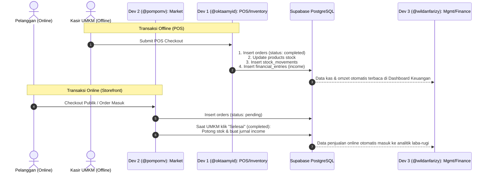

# AI Agent Boundary & Role Governance (`agent-boundaries.md`)
## Product: Niagarupa (Event: Logicodix — Local MSME & Creative Economy Hub)

> [!IMPORTANT]
> **MANDATORY INSTRUCTION FOR ALL AI AGENTS & CODING ASSISTANTS**:
> Dokumen ini adalah kontrak batasan resmi (*Boundary Contract*) bagi seluruh AI Agent (Antigravity, Cursor, Copilot, Windsurf, Claude Code, dll.) yang bekerja mendampingi developer.
> **AI Agent DILARANG KERAS memodifikasi file di luar domain developer yang sedang aktif**, kecuali file kontrak bersama yang disepakati (*Shared Contracts*).

---

## 1. Identitas Tim & Pembagian Domain

| Developer | Identitas GitHub | Domain Tanggung Jawab | Kode Branch Prefix |
| :--- | :--- | :--- | :--- |
| **Developer 1** | **User / `@oktaamyid`** *(Tech Lead)* | **Domain 1: Digitalisasi Operasional UMKM** (Auth, Onboarding, Inventori, Smart POS) | `feat/op-*` |
| **Developer 2** | **`@pompomv`** ([github.com/pompomv](https://github.com/pompomv)) | **Domain 2: Akses Pasar & Ekonomi Kreatif** (Direktori Pasar, Micro-Storefront, WhatsApp Checkout, Orders) | `feat/mkt-*` |
| **Developer 3** | **`@wildanfarizy`** ([github.com/wildanfarizy](https://github.com/wildanfarizy)) | **Domain 3: Optimasi Manajemen Bisnis** (Buku Kas Keuangan, HPP/Margin, Analitik, Deadstock & Restock) | `feat/mgmt-*` |

---

## 2. Matriks Kepemilikan File & Batasan Folder (Strict Boundaries)

```
                            LOGICODIX REPOSITORY
                                     │
      ┌──────────────────────────────┼──────────────────────────────┐
      ▼                              ▼                              ▼
[DEVELOPER 1]                  [DEVELOPER 2]                  [DEVELOPER 3]
@oktaamyid                     @pompomv                       @wildanfarizy
Domain 1: Operational          Domain 2: Market Access        Domain 3: Business Mgmt
─────────────────────          ───────────────────────        ───────────────────────
• app/(auth)/**                • app/(market)/**              • app/(dashboard)/management/**
• app/(dashboard)/operational/ • app/(dashboard)/orders/**    • components/management/**
• components/operational/**    • components/market/**         • lib/db/schema/management.ts
• lib/db/schema/core.ts        • lib/db/schema/market.ts      • lib/schemas/management.schema.ts
• lib/db/schema/operational.ts • lib/schemas/market.schema.ts
• lib/schemas/operational.ts
```

### 2.1 Developer 1 (@oktaamyid) — Domain 1: Digitalisasi Operasional
- **Fitur Utama**:
  1. Multi-role Authentication & Onboarding Toko UMKM (`stores` & `store_members`).
  2. CRUD Produk, Kategori, Harga Pokok Penjualan (HPP / Cost Price), Harga Jual, dan upload media produk ke Supabase Storage.
  3. Mutasi Stok (*Stock Movements*) & Peringatan Stok Rendah (*Low-stock Threshold*).
  4. Kasir Digital (*Smart POS*) kasir offline dengan transaksi atomik dan struk digital.
- **Zona File Diizinkan Tulis (Write Allowed)**:
  - `src/app/(auth)/**`
  - `src/app/(dashboard)/operational/**`
  - `src/components/operational/**`
  - `src/lib/db/schema/core.ts`
  - `src/lib/db/schema/operational.ts`
  - `src/lib/schemas/operational.schema.ts`
  - `src/lib/supabase/**` (bersama Tech Lead)
- **Zona Terlarang Tulis (Forbidden to Write)**:
  - `src/app/(market)/**`
  - `src/app/(dashboard)/orders/**`
  - `src/app/(dashboard)/management/**`
  - `src/lib/db/schema/market.ts`
  - `src/lib/db/schema/management.ts`

### 2.2 Developer 2 (@pompomv) — Domain 2: Akses Pasar & Storefront
- **Fitur Utama**:
  1. Landing page publik & Direktori Eksplorasi UMKM Ekonomi Kreatif (`/explore`) dengan filter kategori (Kuliner, Kriya, Fashion, dll.) & lokasi kota.
  2. Micro-Storefront publik tiap UMKM (`/store/[slug]`) yang tersinkronisasi stok produk secara real-time.
  3. Keranjang belanja publik & checkout otomatis terintegrasi ke WhatsApp penjual serta pembuatan invoice pemesanan.
  4. Dashboard Pesanan Masuk UMKM (`/dashboard/orders`) dan sistem Voucher Promo Toko (`vouchers`).
- **Zona File Diizinkan Tulis (Write Allowed)**:
  - `src/app/(market)/**`
  - `src/app/(dashboard)/orders/**`
  - `src/components/market/**`
  - `src/lib/db/schema/market.ts`
  - `src/lib/schemas/market.schema.ts`
- **Zona Terlarang Tulis (Forbidden to Write)**:
  - `src/app/(auth)/**`
  - `src/app/(dashboard)/operational/**`
  - `src/app/(dashboard)/management/**`
  - `src/lib/db/schema/core.ts`
  - `src/lib/db/schema/operational.ts`
  - `src/lib/db/schema/management.ts`

### 2.3 Developer 3 (@wildanfarizy) — Domain 3: Optimasi Manajemen Bisnis
- **Fitur Utama**:
  1. Buku Kas Keuangan (*Financial Ledger*): Pencatatan pemasukan otomatis (dari POS & Online) serta pengeluaran operasional (bahan baku, sewa, gaji, utilitas, marketing).
  2. Perhitungan instan Laba Kotor (Pendapatan - HPP) dan Laba Bersih (Laba Kotor - Beban Operasional).
  3. Dashboard Analitik Bisnis (`/dashboard/management/analytics`): Tren penjualan mingguan/bulanan, omzet, dan Average Order Value (AOV).
  4. Algoritma Optimasi: Deteksi produk *Fast-Moving*, *High-Margin*, *Deadstock* (tanpa penjualan dalam 30 hari), dan kalkulasi *Days of Inventory Remaining* (peringatan *Restock Segera*).
- **Zona File Diizinkan Tulis (Write Allowed)**:
  - `src/app/(dashboard)/management/**`
  - `src/components/management/**`
  - `src/lib/db/schema/management.ts`
  - `src/lib/schemas/management.schema.ts`
- **Zona Terlarang Tulis (Forbidden to Write)**:
  - `src/app/(auth)/**`
  - `src/app/(market)/**`
  - `src/app/(dashboard)/operational/**`
  - `src/app/(dashboard)/orders/**`
  - `src/lib/db/schema/core.ts`
  - `src/lib/db/schema/operational.ts`
  - `src/lib/db/schema/market.ts`

---

## 3. Zona Kontrak Bersama (Shared Contracts & Read-Only Policy)

File-file berikut adalah **Read-Only** untuk semua developer, kecuali melalui kesepakatan bersama / PR review:
- `src/lib/types/action-response.ts`: Standar response Server Action `ActionResponse<T>`.
- `src/lib/db/index.ts`: Inisialisasi koneksi Drizzle ORM.
- `src/app/(dashboard)/layout.tsx`: Layout shell sidebar dashboard bersama.
- `package.json`: Penambahan dependensi baru wajib disetujui Tech Lead (`@oktaamyid`).

---

## 4. Titik Integrasi Antar-Domain (Cross-Domain Interfaces)

Untuk mencegah modifikasi file antar developer, integrasi dilakukan murni melalui **Data Contract**:



1. **Dev 2 membaca data Dev 1**:
   - Storefront (`@pompomv`) membaca tabel `products` milik Dev 1 menggunakan query `SELECT` (hanya produk dengan `is_published = true` dan `is_active = true`).
   - Dev 2 **TIDAK PERLU** mengedit file `products.ts` milik Dev 1. Cukup import tipe `Product` dari `@/lib/db/schema/operational`.
2. **Dev 3 membaca data Dev 1 dan Dev 2**:
   - Dashboard Analitik & Keuangan (`@wildanfarizy`) membaca tabel `orders`, `order_items`, dan `products` untuk menghitung HPP, laba kotor, dan *deadstock*.
   - Dev 3 **TIDAK PERLU** mengedit file `market.ts` atau `operational.ts`. Cukup import tabel dan relasi yang sudah ada.

---

## 5. Protokol Scope Creep untuk AI Agent

Jika saat mengerjakan tugas dari Developer tertentu, AI Agent menemukan kebutuhan yang menyentuh domain developer lain:
1. **JANGAN LANGSUNG MENGUBAH FILE DOMAIN LAIN**.
2. Buat catatan usulan perubahan pada task / issue.
3. Koordinasikan perubahan antarmuka database atau skema ke developer penanggung jawab domain tersebut.
4. AI Agent hanya fokus menyelesaikan pekerjaan di dalam direktori domain developer aktif.
